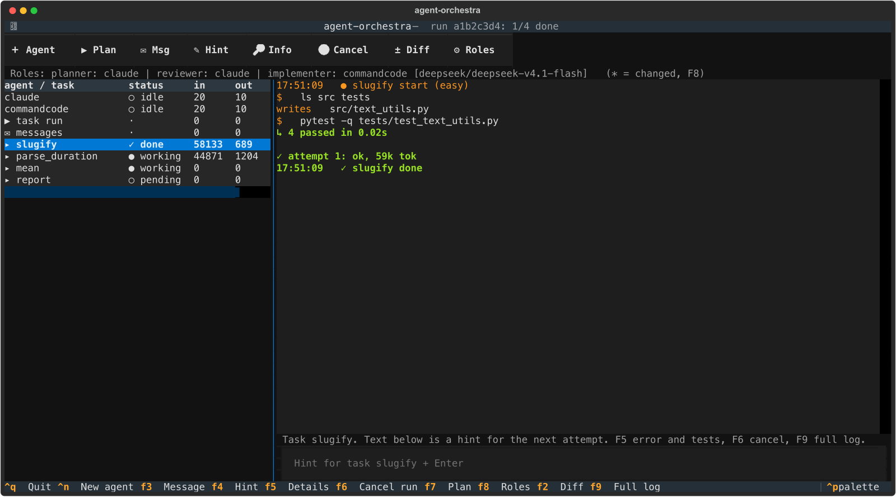
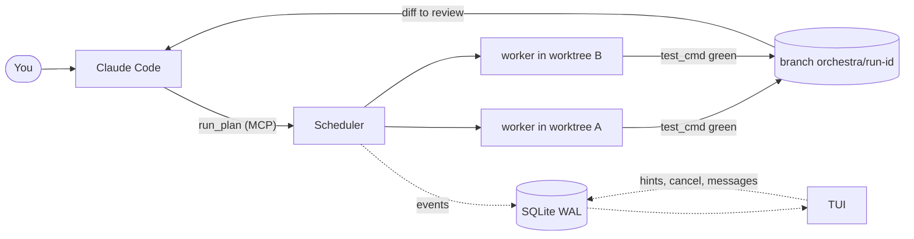
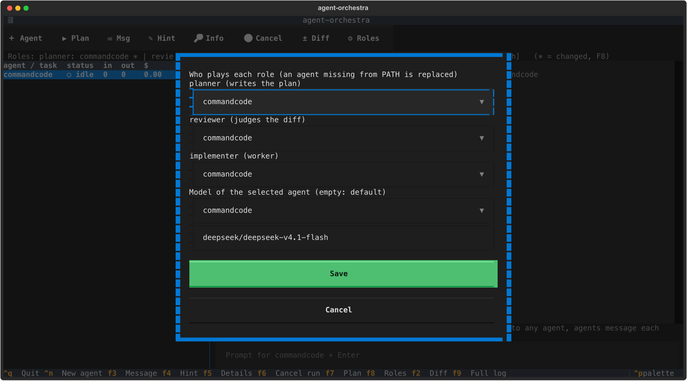
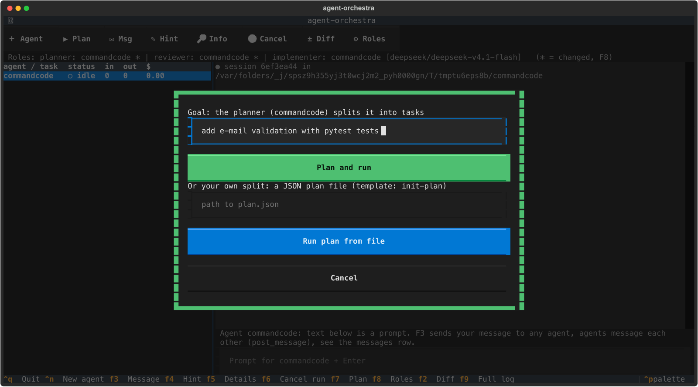
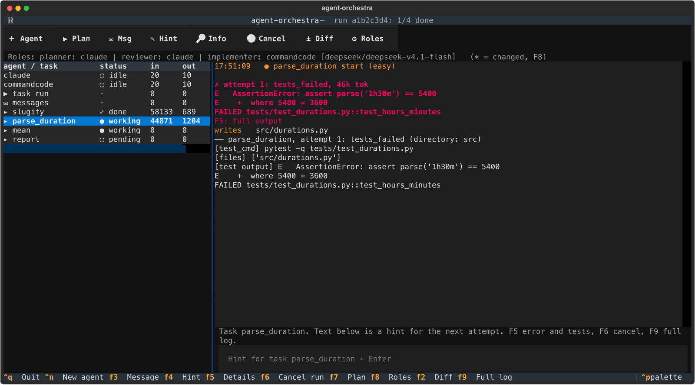
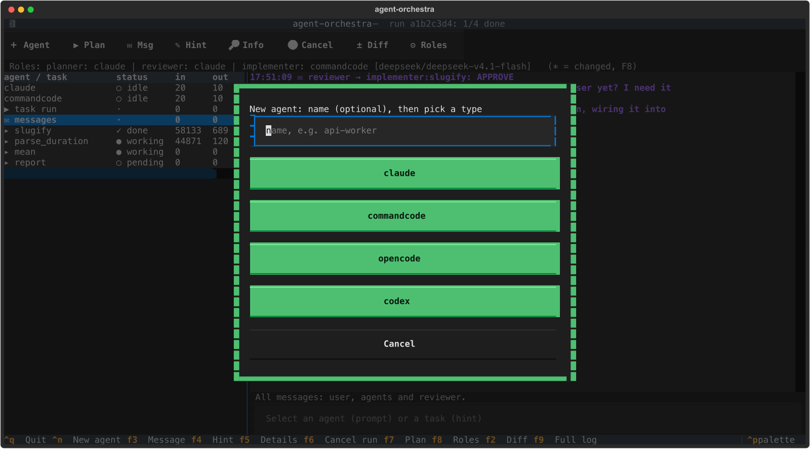
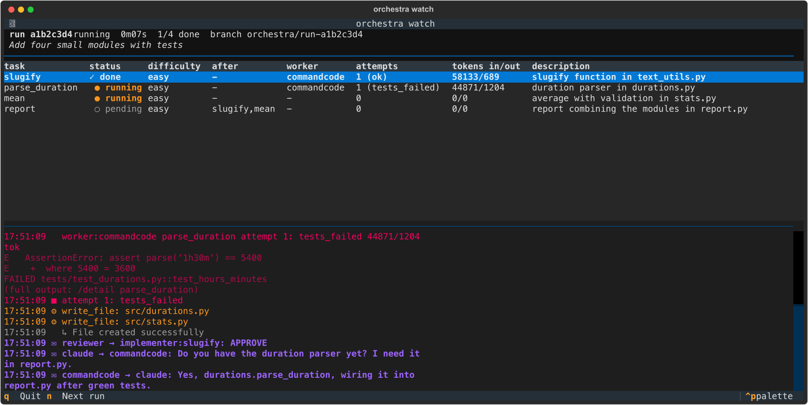

# agent-orchestra

**English** | [Polski](README.pl.md)

**A strong model plans and reviews, cheap models implement. You see everything live and can step in at any moment.**

A cost-aware orchestrator for coding agents. Claude Code breaks a hard task into small, testable pieces, and a cheap worker ([Command Code](https://commandcode.ai), with a model such as DeepSeek) executes them in parallel in isolated git worktrees. A task lands on the shared branch only after its test passes. You watch the whole thing in a terminal UI where you click instead of learning commands.



> The screenshots show a made-up demo run.

## Why

- **Cheaper.** Planning, design and review stay with the strong model, while the tedious implementation goes to a model roughly 20 times cheaper per token.
- **Safer.** Every worker runs in its own worktree and `main` is never touched. Changes come back on an `orchestra/run-<id>` branch that you review and merge yourself.
- **Visible.** Tasks, worker steps (commands, file writes, test results), tokens and agent conversations are all in one window.
- **Steerable.** You can give a worker a hint, cancel a run, add a new agent, message a running agent or inspect a diff.

## How it works



1. You ask Claude for a big task. The `orchestrate-hard-task` skill tells it to split the work into 3 to 8 tasks, each with a description, files, acceptance criteria, a test command (`test_cmd`), a working directory (`cwd`) and dependencies.
2. `run_plan` starts in the background. Tasks without dependencies run in parallel (1 to 3), each in a fresh worktree branched from the integration branch.
3. When `test_cmd` is green, the task is merged (`--no-ff`) into the `orchestra/run-<id>` branch. Dependent tasks see the code of their dependencies.
4. Tasks the worker could not solve go back to Claude. Claude reviews the diff of the whole run, and you do the final merge.

## Quick start

Requirements: Python 3.11+, Node 22+, git, `command-code` (`npm i -g command-code`) and, as the controlling client, one of [Claude Code](https://claude.com/claude-code), OpenCode or Codex (or none, see below). Optionally tmux (the `orch` launcher opens two panes in it).

```bash
git clone https://github.com/GrzegorzSzczepanek/agent-orchestra
cd agent-orchestra
scripts/setup.sh                 # .venv, install, diagnostics (asks about npm i -g command-code)
cmd login                        # manual: opens a browser (on a server: export COMMAND_CODE_API_KEY=...)
.venv/bin/orchestra doctor       # should report no FAIL
```

A global launcher that works from any git repository:

```bash
mkdir -p ~/.local/bin && ln -sf "$PWD/scripts/orch" ~/.local/bin/orch
cd ~/some/repo && orch
```

`orch` opens the client with the `orchestra` server attached (left pane) and the TUI (right pane) in one window. Nothing needs to be registered globally: the MCP server is passed to the client at start. Then ask Claude, for example:

> Use orchestrate-hard-task. Add unit tests for the modules in `src/` that have none. Split it into tasks and hand them to the workers.

Worker model: `default_model` in `agents.toml` (default `deepseek/deepseek-v4.1-flash`), the `ORCHESTRA_CMD_MODEL` variable takes precedence. List models with `cmd --list-models`.

> **Node.** `cmd` and the ACP adapter require Node 22 or newer. `orchestra`, `orchestra-mcp`, `orchestra-client` and `orchestra-tui` prepend a Node 22+ from nvm to PATH on their own when the default Node is older or `cmd` is not on PATH.

## Without Claude, with other providers

Claude is the default, not a requirement. Everything has a fallback, and everything can be changed in the TUI.

**Controlling client.** `orch` picks the first client it finds (`claude`, `opencode`, `codex`) or the one you name with `--client`. The same `orchestra` MCP server and the same task-splitting instructions are attached to each of them, only the wiring differs. If none is installed, `orch` does not fail: it opens the TUI alone, and the **▶ Plan** button (F7) takes a goal, which the planner role splits into tasks, or a plan file that you wrote yourself (`orchestra init-plan` writes a template).

**Roles with a fallback.** `planner`, `reviewer` and `implementer` point at agents in `agents.toml`. If the configured agent is not installed, the role moves to the first available one (planners and reviewers prefer a `strong` tier, workers a `cheap` tier, then the order of `fallback_order`). The bar under the toolbar shows who does what, and `*` marks a change from `agents.toml`. **⚙ Roles** (F8) lets you pick any agent for each role and set its model, and `orchestra roles` does the same from the shell. The choice is saved in `.orchestra/roles.json` and applies to the next run, including runs started from Claude Code, OpenCode or Codex. A weaker planner splits tasks worse, which is the price of not having a strong model.



The screenshot is a demo where `claude` and `codex` are missing from PATH, so the roles moved to Command Code (`*`).

**Your own provider or model.** Add any CLI that can take a task and edit files in the current directory, in `~/.config/orchestra/agents.toml` (all repos) or `<repo>/.orchestra/agents.toml` (one repo). Entries are merged over `agents.toml`:

```toml
[agents.mycli]
headless = ["mycli", "run", "{task}", "--model", "{model}"]
default_model = "local/llama"   # or model_env = "MYCLI_MODEL"
tier = "cheap"                  # "strong" makes it a preferred planner and reviewer

[roles]
implementer = "mycli"
```

**Your own split.** Skip the planner entirely: `orchestra init-plan plan.json`, edit it, then `orchestra run plan.json` or **▶ Plan** in the TUI.



| Client | Status |
| --- | --- |
| Claude Code | verified end to end (run, TUI, review of the diff) |
| none (TUI only) | verified end to end with a Command Code planner and workers, with `claude` missing from PATH |
| OpenCode | verified with a scripted model: the MCP server connects, the instructions arrive, `run_plan` and `run_status` run without approval prompts and a worker's tests land on the integration branch. A real model was not tried (the free quota ran out on the test machine) |
| Codex | verified with Codex 0.172.0 and a scripted model: the MCP server is registered, the instructions arrive, `run_plan` and `run_status` run without approval prompts and a worker's tests land on the integration branch. A real OpenAI model was not tried (no login), see [MCP](https://developers.openai.com/codex/mcp) and [config](https://developers.openai.com/codex/config-reference) |

## Interface

Everything is visible at once, and every action has both a button and a function key (the text shortcuts `/hint`, `/detail`, `/cancel` and `/msg` exist, but you do not need them).

| Button | Key | What it does |
| --- | --- | --- |
| ＋ Agent | Ctrl+N | new agent session of any type from `agents.toml`, in its own worktree |
| ▶ Plan | F7 | a goal for the planner role, or your own plan file, runs without any client |
| ⚙ Roles | F8 | which agent and model plays planner, reviewer, implementer |
| ✉ Msg | F3 | message to a running agent, delivered as its next prompt |
| ✎ Hint | F4 | text appended to the next attempt of the chosen task's worker |
| 🔎 Info (details) | F5 | error, `test_cmd`, full test output and files of the last attempt |
| ⛔ Cancel | F6 | kills the working workers and ends the run (with confirmation) |
| ± Diff | F2 | diff of the selected agent's worktree |

Select a row on the left and the text field changes meaning: for an agent it is a prompt, for a task it is a hint (the line under the log tells you what will happen).

When a worker attempt fails its tests, you see the cause, not just a status:



Agent conversations and reviewer remarks are in the `✉ messages` row. You add a new agent from a list, without typing commands:



For just watching tasks, without prompts, there is a lightweight view, `orchestra watch` (or `orch --simple-watch`):



## Agents talk to each other

Every agent started from the TUI gets the `orchestra` MCP server attached through `session/new`, with the tools `post_message`, `read_inbox` and `list_agents`. A message to a running agent (from you or from another agent) reaches it as its next prompt, with an instruction on how to reply. After 10 agent-to-agent messages in a row without you, relaying pauses so the conversation cannot loop and burn tokens.

Workers from `run_plan` are one-shot `cmd -p` calls, so they do not converse while working. They can receive a hint before the next attempt, and the optional review round (`review_rounds`) sends the reviewer's remarks back to them.

## MCP tools

| Tool | Description |
| --- | --- |
| `run_plan(goal, tasks, parallel, review_rounds, ...)` | runs a task plan (DAG) with workers in the background, returns a `run_id` immediately |
| `run_status(run_id, wait_s)` | task states, and after completion a report and the `orchestra/run-<id>` branch to review |
| `delegate(prompt, test_cmd, ...)` | a single simple task in its own worktree, with a diff and test result |
| `post_message`, `read_inbox`, `list_agents` | message inbox between agents |

A `run_plan` task has: `id`, `description`, `files`, `acceptance`, `test_cmd` (a command without a shell, e.g. `pytest -q tests/test_x.py`), `cwd` (a repo subdirectory where the worker and the test run), `difficulty` (`easy`, `medium`, `hard`), `depends_on`. Workers start from the committed `HEAD`, so uncommitted changes are invisible to them (the `orch` launcher warns about them).

## Cost hierarchy and safeguards

- **Test gate:** `test_cmd` must pass before a task branch is merged. A merge conflict counts as a failure.
- **Escalation:** after 2 consecutive failures of the cheap worker, the task gets one attempt from the `planner` role (in the `orchestra run` CLI). In `run_plan` from Claude Code, escalation is off: a failed task goes back to Claude.
- **Budget:** a token limit (default 400k) and optionally a cost limit per task, computed from the SQLite log.
- **Test command check:** if the `test_cmd` program is not found, the task stops before the worker spends any tokens.
- **Red check:** the `test_cmd` of a task must fail before the worker touches anything (`red_check`, on by default in `run_plan`). If it already passes, the task ends as `red_check_failed` without retries: it is either empty or the test verifies nothing. Set `expect_red` to false for refactors. `orchestra run --no-red-check` turns it off.
- **Integration gate:** `integration_test_cmd` (CLI: `--integration-test`) runs the full test suite on the integration branch after every merge. If it is red, the merge is reverted and the task goes back to the worker with the output. The base must be green, otherwise the run does not start.
- **Session budget:** `orchestra ledger budget --set 1.0` starts a session with a cap in USD for worker spending. The cost is estimated from tokens and `price_in_per_mtok` and `price_out_per_mtok` in `agents.toml` (peak rate, no cache discount, so it is an upper bound). Once the cap is reached, `run_plan` and `delegate` refuse to start and running tasks end as `over_budget`. `orchestra ledger budget --check` exits with code 3 when the cap is exceeded.
- **Delegation ledger:** `orchestra ledger add RUN TASK --outcome accepted|fixed|rejected` records what the strong model spent on the spec and the review (estimated as characters divided by 4) next to the worker's tokens. `orchestra ledger show` prints the table and a proposed threshold: delegate when the expected diff is larger than the mean overhead divided by the acceptance rate.
- **Fatal errors** (bad configuration, not logged in, no credits) end the task without retries and stop the rest of the run.
- **Reviewer:** `review_rounds` 1 to 2 after green tests. Research on multi-agent debate gives mixed results at a higher cost, so it is off by default.
- **Environment:** the `cmd` worker gets `--yolo`, because the worktree is the isolation. Do not run it on a repository with secrets the worker should not see. The ACP SDK passes agents a trimmed environment, so secrets must be listed explicitly in `env_passthrough`.

Real cost: a single worker attempt on real tasks uses on the order of 50 to 170k input tokens (mostly context and cache), and the fixed overhead of `cmd -p` is about 15k tokens. It pays off for tasks with a clear test and 1 to 3 files, not for one-line fixes.

## Configuration and CLI

`agents.toml` describes the agents (ACP command, headless command, `env_passthrough`, model, cost tier) and roles (`planner`, `reviewer`, `implementer`). Built in: Claude Code (through an ACP adapter), Command Code, Codex, Antigravity, OpenCode.

```
orchestra doctor [--smoke] [--model ID]        diagnostics: cmd, login, models, headless, ACP, other agents
orchestra plan "goal" [--out plan.json]        the planner role produces a task DAG as JSON
orchestra run plan.json [--parallel 2] [--rounds 0] [--token-budget 400000]
orchestra roles [--set planner=AGENT] [--model AGENT=MODEL]   who plays which role (with fallback)
orchestra init-plan [plan.json]                a template for splitting tasks yourself
orchestra watch [--repo .]                     live view of runs (read only)
orchestra-tui --repo . --agents commandcode    TUI (--demo shows mock agents)
orchestra-mcp                                  MCP server (stdio)
orch [DIR] [--client auto|claude|opencode|codex|none] [--agents a,b] [--no-watch]   client + TUI in one window
scripts/go.sh "goal" [--claude] [--plan-only]  plan and run in one command, without Claude Code
```

## Layout

```
agents.toml           agents, roles, worker model
.mcp.json             MCP server for Claude Code started in this repo
.agents/skills/       skills (orchestrate-hard-task, delegate-simple-tasks), .claude/skills is a symlink
src/orchestra/        scheduler, plan (DAG, pydantic), delegate, worktree, mcp_server, acp_client,
                      controller, store (SQLite WAL), progress, tui, watch, doctor, node_env, clients, cli
scripts/              setup.sh, orch, go.sh, make_screenshot.py (README screenshots)
tests/                pytest, including anonymised fixtures from real cmd and claude output
```

Stack: [Model Context Protocol](https://modelcontextprotocol.io) (FastMCP), [Agent Client Protocol](https://agentclientprotocol.com) (official SDK), Textual, pydantic, `graphlib`, SQLite.

## Tests and verification status

```bash
.venv/bin/pytest        # 123 tests
```

**Verified on a real environment** (macOS, Node 22, `cmd` 1.93.2, `claude` 2.1.x):
- `orchestra doctor`: login, model list, headless, ACP `initialize` and `session/new`.
- `run_plan` and `run_status` through a real MCP server (stdio) with a `cmd` worker: 3 tasks, one depending on the other two, all merged, tests green on the integration branch.
- Attaching the `orchestra` server to a `cmd acp` session: the agent called `list_agents` and `post_message` on its own.
- The Claude planner (`claude -p`) returns a valid DAG and the worker carries it out end to end.
- `orch` through a real Claude Code in tmux: 3 parallel tasks, TUI live, diff reviewed by Claude, 17 tests green on the integration branch.
- No Claude at all (`claude` missing from PATH): `orch` opens the TUI alone, the planner and reviewer roles fall back to Command Code, a goal typed into **▶ Plan** is split into 4 tasks and all 4 are merged, tests green.
- OpenCode and Codex 0.172.0 through `orch`, each with a scripted local model and a real Command Code worker: `run_plan` and `run_status` called, task merged, tests green.

**Verified by tests** (mocks and anonymised recordings): the `cmd` and `claude` NDJSON parser, exit codes, doctor, DAG validation, the scheduler (parallelism, merging, test gate, escalation, budget, merge conflict, fatal error, cancellation, hints), task `cwd`, the MCP server, the ACP client, the TUI (buttons, dialogs, capped message relaying).

**Not verified:**
- The review round on a real Claude (`review_rounds`): mocks only.
- `codex`, `codex-acp` and `agy`: no binaries, the checks are skipped. 
- A real model behind OpenCode or Codex: the end-to-end runs used a scripted local model, so whether a real model chooses `run_plan` on its own is untested.
- OpenCode as a worker: its free quota ran out on the test machine.
- Worker cost in USD: `cmd` does not report it, so the `$` column is zero for it.
- An interactive Claude Code session calling `run_plan` on a large, real repository.

## Limitations and ideas

- `run_plan` workers have no MCP attached, so they do not consult each other mid-task (that would require moving from `cmd -p` to ACP sessions).
- Cancelling a run leaves worktrees to clean up: `git worktree prune`, and delete the `orchestra/*` branches after merging.
- No retry of a single task from the TUI yet (for now a hint, and Claude re-runs it).
- USD cost computed from model price lists, a Docker sandbox for YOLO mode, continuing work in the same worktree after reviewer remarks.

Running an unmodified `claude` on your own account is, in the author's reading, consistent with Anthropic's documentation, but the terms change, so check the current ones before using this in production.

## License

[MIT](LICENSE)
