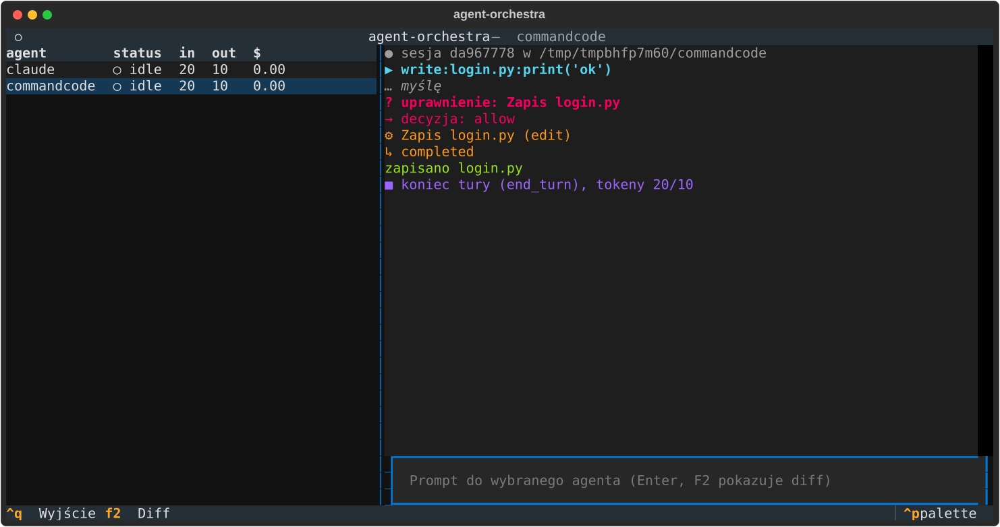

# agent-orchestra

Orkiestrator agentów kodujących z hierarchią kosztową. Mocny model (Claude) planuje, robi research i recenzuje diffy, a tani worker z commandcode.ai implementuje proste ficzery w izolowanym git worktree. Całość widać w terminalu (Textual).

## Założenia

- Reużycie gotowców: oficjalne Python SDK protokołu ACP, FastMCP, Textual, SQLite, git worktree.
- Wspólne skille: `.agents/skills/` jest źródłem prawdy, `.claude/skills` to symlink. `AGENTS.md` jest wspólną instrukcją, `CLAUDE.md` importuje `@AGENTS.md`.
- Konfiguracja agentów i ról w `agents.toml`.

## Status etapów

- [x] 1. Szkielet repo i konfiguracja
- [x] 2. Serwer MCP z narzędziem `delegate`
- [x] 3. Warstwa ACP i log zdarzeń w SQLite
- [x] 4. TUI w Textual

## Uruchomienie

```
uv venv && uv pip install -e ".[dev]"
.venv/bin/pytest
```

## Narzędzie MCP `delegate`

Rejestracja w Claude Code (stdio):

```
claude mcp add orchestra -e ORCHESTRA_REPO=$PWD -e ORCHESTRA_CONFIG=$PWD/agents.toml -- $PWD/.venv/bin/orchestra-mcp
```

Narzędzie tworzy worktree `.orchestra/worktrees/<id>` na gałęzi `orchestra/<id>`, uruchamia workera headless (domyślnie rola `implementer`, czyli `cmd -p ... --output-format json`), odpala `test_cmd` (bez powłoki) i zwraca diff względem bazy, wynik testów i zużycie tokenów. Worker `fake` zapisuje pliki z `fake_files` i służy do testów.

## Warstwa ACP i log zdarzeń

- `orchestra.acp_client.AgentSession`: uruchamia agenta (`spawn_agent_process` z oficjalnego SDK), robi `initialize`, `session/new` (z `cwd` worktree i `mcpServers`), `session/prompt`, anulowanie. Aktualizacje `session/update` są normalizowane do zdarzeń: `agent_message`, `agent_thought`, `tool_call`, `tool_update`, `context`, `permission_request`, `permission_response`, `prompt_start`, `prompt_end`, `error`.
- Zużycie tokenów z `PromptResponse.usage` (jeśli agent je zwraca) trafia do kolumn `tokens_in` i `tokens_out`, koszt z `usage_update` do `cost`.
- Uprawnienia: domyślnie `reject_all`; handler jest podmienialny (TUI podstawi okno akceptacji).
- `orchestra.store.EventStore`: SQLite w trybie WAL, tabele `events` i `messages`. Serwer MCP wystawia też `post_message` i `read_inbox` jako skrzynkę między agentami.
- `orchestra.testing.mock_agent`: minimalny agent ACP do testów i demo (`python -m orchestra.testing.mock_agent`).

## TUI (Textual)

```
.venv/bin/orchestra-tui --demo                      # dwa agenty mock
.venv/bin/orchestra-tui --repo . --agents claude,commandcode   # worktree na agenta + sesje ACP z agents.toml
```

Lewy panel: tabela agentów (status, tokeny wejście/wyjście, koszt). Prawy: strumień zdarzeń wybranego agenta, pole promptu na dole, `F2` pokazuje diff worktree względem HEAD, okno modalne akceptacji uprawnień ACP (Esc odmawia). Zrzuty: `docs/screenshot.svg`, `docs/screenshot-permission.svg` (generuje `scripts/make_screenshot.py`).



## Zweryfikowane vs niezweryfikowane

Zweryfikowane (testy pytest, 26 przechodzi, środowisko: Python 3.13, agent-client-protocol 1.0.0, fastmcp 4.2.5, textual 8.2.8):
- Konfiguracja, worktree, `delegate` z workerem `fake` i z workerem-skryptem naśladującym format NDJSON z `cmd -p --output-format json`.
- Serwer MCP po stdio (prawdziwy podproces) i w pamięci, narzędzia `delegate`, `post_message`, `read_inbox`.
- Klient ACP przeciw mockowemu agentowi (initialize, session/new z cwd i mcpServers, prompt, uprawnienia, anulowanie, zużycie tokenów) oraz zapis do SQLite w trybie WAL.
- TUI w trybie testowym (Pilot): replay i polling zdarzeń, wybór agenta, prompt, modal uprawnień (zgoda i odmowa), widok diffu.

Niezweryfikowane (brak zainstalowanych agentów w środowisku budowy):
- Rzeczywiste uruchomienie `cmd`, `agy`, `claude-agent-acp`, `codex-acp`, `opencode` i ich zachowanie po ACP. Komendy w `agents.toml` pochodzą z dokumentacji (commandcode.ai/docs/acp i /docs/headless dla `cmd`), pozostałe z raportu research i wymagają sprawdzenia na Twojej maszynie (flagi `agy -p`, `codex exec`, `opencode run`).
- Nazwa modelu `deepseek/deepseek-v4.1-flash` w `agents.toml`: `cmd` odrzuca nieznane identyfikatory, więc sprawdź `cmd` pod kątem listy modeli.
- Czy dany agent zwraca `usage` w `PromptResponse` (Command Code: dokumentacja tego nie obiecuje, ma tylko miernik kontekstu). Bez tego kolumny tokenów w TUI pozostaną zerowe.
- Format JSON innych agentów niż Command Code w trybie headless (parser rozumie tylko `type: result` z `finalText` i `usage`).
- Regulamin: sterowanie niezmodyfikowanym `claude` przez adapter na własnym koncie jest zgodne z dokumentacją Anthropic wg raportu, ale sprawdź aktualną wersję strony Legal and compliance.

## TODO

- Planista zwracający DAG zadań w JSON, scheduler z równoległością 2 lub 3 i bramka testów (etap 4 planu z raportu).
- Eskalacja do mocnego modelu po dwóch porażkach testów oraz budżet tokenów na zadanie.
- Limit rund i sędzia dla dyskusji między agentami (domyślnie wyłączona).
- Wspólne skille i MCP wstrzykiwane przez `session/new` do każdego agenta (mechanizm `mcp_servers` jest gotowy, brakuje konfiguracji).
- Sandbox Docker dla trybów YOLO.
- Fragmenty strumienia odpowiedzi dzielące się na granicy odpytywania mogą zostać wypisane w osobnych liniach.
- Koszt w USD liczony z cennika modeli (obecnie tylko z `usage_update`, jeśli agent go wysyła).
