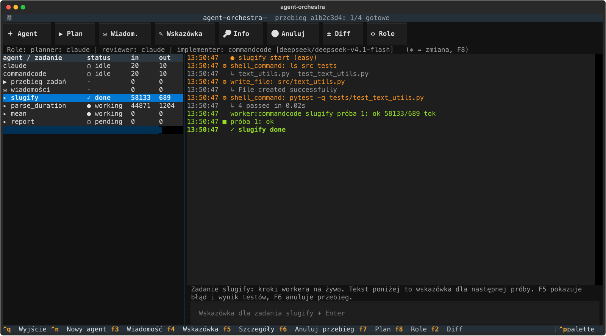
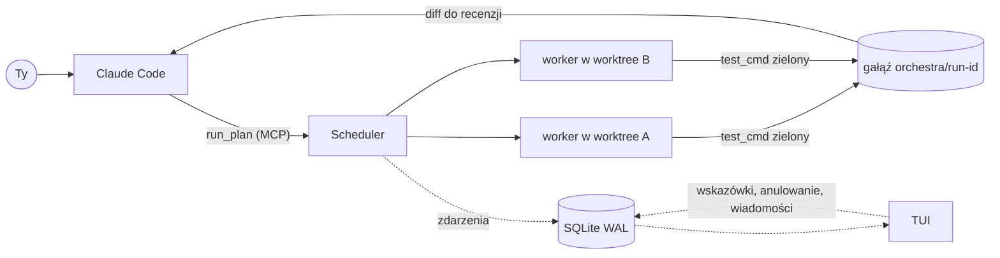
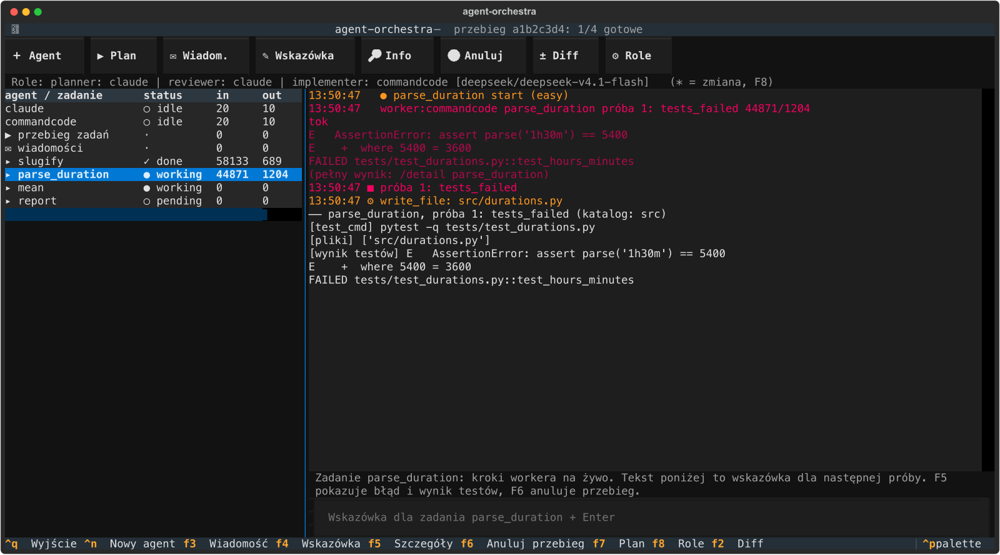
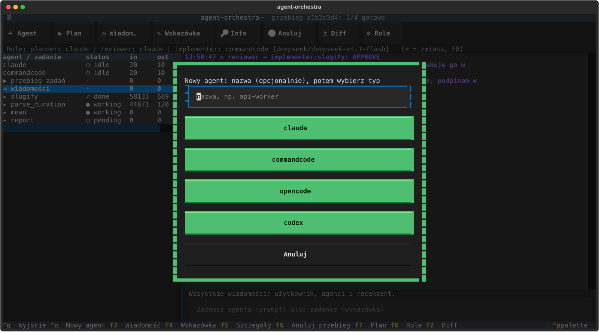
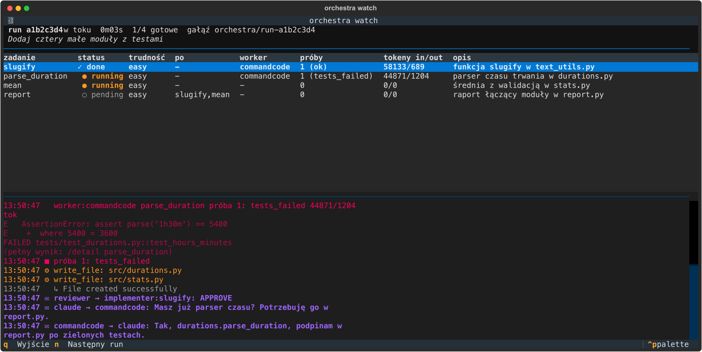

# agent-orchestra

[English](README.md) | **Polski**

**Mocny model planuje i recenzuje, tanie modele implementują. Ty widzisz wszystko na żywo i możesz wtrącić się w każdej chwili.**

Orkiestrator agentów kodujących z hierarchią kosztową. Claude Code rozbija trudne zadanie na małe, testowalne części, a tani worker ([Command Code](https://commandcode.ai), model np. DeepSeek) wykonuje je równolegle w izolowanych git worktree. Zadanie trafia do wspólnej gałęzi dopiero po zielonym teście. Całość oglądasz w terminalowym interfejsie, w którym klikasz zamiast uczyć się komend.



## Po co

- **Taniej.** Planowanie, projektowanie i recenzja zostają przy mocnym modelu, a żmudna implementacja idzie do modelu około 20 razy tańszego za token.
- **Bezpieczniej.** Każdy worker pracuje w osobnym worktree, a `main` nie jest ruszany. Zmiany wracają na gałąź `orchestra/run-<id>`, którą recenzujesz i scalasz sam.
- **Widocznie.** Zadania, kroki workerów (komendy, zapisy plików, wyniki testów), tokeny i rozmowy agentów są w jednym oknie.
- **Sterowalnie.** Możesz dać workerowi wskazówkę, anulować przebieg, dodać nowego agenta, napisać do działającego agenta albo obejrzeć diff.

## Jak to działa



1. Prosisz Claude'a o duże zadanie. Skill `orchestrate-hard-task` każe mu rozbić je na 3 do 8 zadań z opisem, plikami, kryteriami, komendą testową (`test_cmd`), katalogiem (`cwd`) i zależnościami.
2. `run_plan` startuje w tle. Zadania bez zależności idą równolegle (1 do 3), każde w świeżym worktree odgałęzionym od gałęzi integracyjnej.
3. Po zielonym `test_cmd` zadanie jest scalane (`--no-ff`) do gałęzi `orchestra/run-<id>`. Zadania zależne widzą kod swoich zależności.
4. Zadania, których worker nie rozwiązał, wracają do Claude'a. Diff całego przebiegu recenzuje Claude, a scala Ty.

## Szybki start

Wymagania: Python 3.11+, Node 22+, git, `command-code` (`npm i -g command-code`) oraz klient sterujący: [Claude Code](https://claude.com/claude-code), OpenCode albo Codex (albo żaden, patrz niżej). Opcjonalnie tmux (launcher `orch` sam otwiera w nim dwa panele).

```bash
git clone https://github.com/GrzegorzSzczepanek/agent-orchestra
cd agent-orchestra
scripts/setup.sh                 # .venv, instalacja, diagnostyka (pyta o npm i -g command-code)
cmd login                        # ręcznie: otwiera przeglądarkę (na serwerze: export COMMAND_CODE_API_KEY=...)
.venv/bin/orchestra doctor       # powinno być bez FAIL
```

Globalny launcher, który działa z dowolnego repozytorium git:

```bash
mkdir -p ~/.local/bin && ln -sf "$PWD/scripts/orch" ~/.local/bin/orch
cd ~/jakies/repo && orch
```

`orch` otwiera w jednym oknie klienta z podpiętym serwerem `orchestra` (lewy panel) oraz TUI (prawy panel). Nic nie trzeba rejestrować globalnie: serwer MCP jest podawany klientowi przy starcie. Potem napisz do Claude'a, np.:

> Użyj orchestrate-hard-task. Dopisz testy jednostkowe do modułów w `src/`, które ich nie mają. Rozbij to na zadania i rozdaj workerom.

Model workera: `default_model` w `agents.toml` (domyślnie `deepseek/deepseek-v4.1-flash`), zmienna `ORCHESTRA_CMD_MODEL` ma pierwszeństwo. Lista modeli: `cmd --list-models`.

> **Node.** `cmd` i adapter ACP wymagają Node 22 lub nowszego. `orchestra`, `orchestra-mcp`, `orchestra-client` i `orchestra-tui` same dopisują do PATH Node 22+ z nvm, gdy domyślny jest starszy albo `cmd` nie jest w PATH.

## Bez Claude'a i z innymi providerami

Claude jest domyślny, ale nie wymagany. Wszystko ma fallback i wszystko da się zmienić w TUI.

**Klient sterujący.** `orch` wybiera pierwszego znalezionego klienta (`claude`, `opencode`, `codex`) albo tego, którego podasz w `--client`. Do każdego podpina ten sam serwer MCP `orchestra` i tę samą instrukcję rozbijania zadań, różni się tylko sposób podłączenia. Gdy nie ma żadnego, `orch` nie kończy się błędem: otwiera samo TUI, a przycisk **▶ Plan** (F7) przyjmuje cel, który rola planner rozbija na zadania, albo plik planu napisany przez Ciebie (szablon zapisze `orchestra init-plan`).

**Role z fallbackiem.** `planner`, `reviewer` i `implementer` wskazują agentów z `agents.toml`. Jeśli wskazany agent nie jest zainstalowany, rola przechodzi na pierwszego dostępnego (planner i reviewer wolą poziom `strong`, worker `cheap`, potem kolejność z `fallback_order`). Pasek pod przyciskami pokazuje, kto co robi, a `*` oznacza zmianę względem `agents.toml`. **⚙ Role** (F8) pozwala wybrać dowolnego agenta dla każdej roli i ustawić jego model, to samo robi `orchestra roles` w terminalu. Wybór zapisuje się w `.orchestra/roles.json` i obowiązuje od następnego przebiegu, także tych uruchomionych z Claude Code, OpenCode albo Codex. Słabszy planner gorzej dzieli zadania, taka jest cena braku mocnego modelu.

**Własny provider albo model.** Dopisz dowolne CLI, które przyjmuje zadanie i edytuje pliki w bieżącym katalogu, w `~/.config/orchestra/agents.toml` (wszystkie repo) albo `<repo>/.orchestra/agents.toml` (jedno repo). Wpisy nakładają się na `agents.toml`:

```toml
[agents.mycli]
headless = ["mycli", "run", "{task}", "--model", "{model}"]
default_model = "local/llama"   # albo model_env = "MYCLI_MODEL"
tier = "cheap"                  # "strong" robi z niego preferowanego plannera i recenzenta

[roles]
implementer = "mycli"
```

**Własny podział.** Możesz pominąć plannera: `orchestra init-plan plan.json`, edycja, potem `orchestra run plan.json` albo **▶ Plan** w TUI.

| Klient | Stan |
| --- | --- |
| Claude Code | zweryfikowany end-to-end (przebieg, TUI, recenzja diffu) |
| brak (samo TUI) | zweryfikowany end-to-end z plannerem i workerami Command Code, przy braku `claude` w PATH |
| OpenCode | serwer MCP się łączy (`opencode mcp list`), wołanie narzędzi przez model niezweryfikowane (darmowy limit skończył się na maszynie testowej) |
| Codex | podpięcie napisane według dokumentacji [MCP](https://developers.openai.com/codex/mcp) i [konfiguracji](https://developers.openai.com/codex/config-reference), pokryte tylko testami jednostkowymi, brak binarki do uruchomienia |

## Interfejs

Wszystko jest widoczne od razu, a każda akcja ma przycisk i F-klawisz (skróty tekstowe `/hint`, `/detail`, `/cancel`, `/msg` istnieją, ale nie są potrzebne).

| Przycisk | Klawisz | Co robi |
| --- | --- | --- |
| ＋ Agent | Ctrl+N | nowa sesja agenta dowolnego typu z `agents.toml`, we własnym worktree |
| ▶ Plan | F7 | cel dla roli planner albo własny plik planu, działa bez żadnego klienta |
| ⚙ Role | F8 | który agent i model pełni rolę planner, reviewer, implementer |
| ✉ Wiadom. | F3 | wiadomość do działającego agenta, dociera jako jego kolejny prompt |
| ✎ Wskazówka | F4 | tekst dołączany do następnej próby workera wybranego zadania |
| 🔎 Info | F5 | błąd, `test_cmd`, pełny wynik testów i pliki ostatniej próby |
| ⛔ Anuluj | F6 | zabija pracujące workery i kończy przebieg (z potwierdzeniem) |
| ± Diff | F2 | diff worktree zaznaczonego agenta |

Zaznacz wiersz po lewej, a pole tekstowe zmienia znaczenie: dla agenta to prompt, dla zadania to wskazówka (podpowiedź pod logiem mówi, co się stanie).

Gdy próba workera nie przechodzi testów, widać przyczynę, a nie tylko status:



Rozmowy agentów i uwagi recenzenta są w wierszu `✉ wiadomości`. Nowego agenta dodajesz z listy, bez wpisywania komend:



Do samego podglądu zadań, bez promptów, jest osobny, lekki widok `orchestra watch` (albo `orch --simple-watch`):



## Agenci rozmawiają ze sobą

Każdy agent startowany z TUI dostaje przez `session/new` podpięty serwer MCP `orchestra` z narzędziami `post_message`, `read_inbox` i `list_agents`. Wiadomość do działającego agenta (od Ciebie albo od innego agenta) trafia do niego jako kolejny prompt z instrukcją, jak odpowiedzieć. Po 10 wiadomościach agentów z rzędu bez Ciebie przekazywanie jest wstrzymywane, żeby rozmowa nie zapętliła się i nie paliła tokenów.

Workery z `run_plan` to jednorazowe wywołania `cmd -p`, więc nie rozmawiają w trakcie pracy. Mogą dostać wskazówkę przed następną próbą, a opcjonalna runda recenzji (`review_rounds`) odsyła do nich uwagi recenzenta.

## Narzędzia MCP

| Narzędzie | Opis |
| --- | --- |
| `run_plan(goal, tasks, parallel, review_rounds, ...)` | wykonuje plan zadań (DAG) workerami w tle, zwraca `run_id` od razu |
| `run_status(run_id, wait_s)` | stan zadań, po zakończeniu raport i gałąź `orchestra/run-<id>` do recenzji |
| `delegate(prompt, test_cmd, ...)` | pojedyncze proste zadanie w osobnym worktree z diffem i wynikiem testów |
| `post_message`, `read_inbox`, `list_agents` | skrzynka wiadomości między agentami |

Zadanie w `run_plan`: `id`, `description`, `files`, `acceptance`, `test_cmd` (komenda bez powłoki, np. `pytest -q tests/test_x.py`), `cwd` (podkatalog repo, w którym działa worker i test), `difficulty` (`easy`, `medium`, `hard`), `depends_on`. Workery startują z zacommitowanego `HEAD`, więc niezacommitowane zmiany są dla nich niewidoczne (launcher `orch` ostrzega o nich).

## Hierarchia kosztowa i zabezpieczenia

- **Bramka testów:** `test_cmd` musi przejść, zanim gałąź zadania zostanie scalona. Konflikt scalenia liczy się jak porażka.
- **Eskalacja:** po 2 kolejnych porażkach taniego workera zadanie dostaje jedną próbę od roli `planner` (w CLI `orchestra run`). W `run_plan` z Claude Code eskalacja jest wyłączona: nieudane zadanie wraca do Claude'a.
- **Budżet:** limit tokenów (domyślnie 400 tys.) i opcjonalnie kosztu na zadanie, liczone z logu SQLite.
- **Kontrola test_cmd:** gdy programu z `test_cmd` nie ma w PATH, zadanie zatrzymuje się, zanim worker zużyje tokeny.
- **Błędy krytyczne** (zła konfiguracja, brak logowania, brak kredytów) kończą zadanie bez ponawiania i zatrzymują resztę przebiegu.
- **Recenzent:** `review_rounds` 1 do 2 po zielonych testach. Badania nad debatą wieloagentową dają mieszane wyniki i wyższy koszt, więc domyślnie jest wyłączona.
- **Środowisko:** worker `cmd` dostaje `--yolo`, bo izolacją jest worktree. Nie uruchamiaj go na repozytorium z sekretami, których worker nie powinien widzieć. SDK ACP przekazuje agentom okrojone środowisko, sekrety trzeba wymienić jawnie w `env_passthrough`.

Realny koszt: pojedyncza próba workera w prawdziwych zadaniach zużywa rzędu 50 do 170 tys. tokenów wejścia (głównie kontekst i cache), a stały narzut `cmd -p` to około 15 tys. tokenów. Opłaca się to dla zadań z jasnym testem i 1 do 3 plikami, a nie dla jednolinijkowych poprawek.

## Konfiguracja i CLI

`agents.toml` opisuje agentów (komenda ACP, komenda headless, `env_passthrough`, model, poziom kosztowy) i role (`planner`, `reviewer`, `implementer`). Wbudowani: Claude Code (przez adapter ACP), Command Code, Codex, Antigravity, OpenCode.

```
orchestra doctor [--smoke] [--model ID]        diagnostyka: cmd, logowanie, modele, headless, ACP, inni agenci
orchestra plan "cel" [--out plan.json]         rola planner układa DAG zadań w JSON
orchestra run plan.json [--parallel 2] [--rounds 0] [--token-budget 400000]
orchestra roles [--set planner=AGENT] [--model AGENT=MODEL]   kto pełni które role (z fallbackiem)
orchestra init-plan [plan.json]                szablon do ręcznego podziału zadań
orchestra watch [--repo .]                     podgląd przebiegów na żywo (tylko odczyt)
orchestra-tui --repo . --agents commandcode    TUI (--demo pokazuje agenty mock)
orchestra-mcp                                  serwer MCP (stdio)
orch [KATALOG] [--client auto|claude|opencode|codex|none] [--agents a,b] [--no-watch]   klient + TUI w jednym oknie
scripts/go.sh "cel" [--claude] [--plan-only]   plan i wykonanie jednym poleceniem, bez Claude Code
```

## Struktura

```
agents.toml           agenci, role, model workera
.mcp.json             serwer MCP dla Claude Code uruchomionego w tym repo
.agents/skills/       skille (orchestrate-hard-task, delegate-simple-tasks), .claude/skills to symlink
src/orchestra/        scheduler, plan (DAG, pydantic), delegate, worktree, mcp_server, acp_client,
                      controller, store (SQLite WAL), progress, tui, watch, doctor, node_env, clients, cli
scripts/              setup.sh, orch, go.sh, make_screenshot.py (zrzuty do README)
tests/                pytest, w tym zanonimizowane fixture'y z prawdziwego wyjścia cmd i claude
```

Stack: [Model Context Protocol](https://modelcontextprotocol.io) (FastMCP), [Agent Client Protocol](https://agentclientprotocol.com) (oficjalne SDK), Textual, pydantic, `graphlib`, SQLite.

## Testy i stan weryfikacji

```bash
.venv/bin/pytest        # 123 testy
```

**Zweryfikowane na prawdziwym środowisku** (macOS, Node 22, `cmd` 1.93.2, `claude` 2.1.x):
- `orchestra doctor`: logowanie, lista modeli, headless, ACP `initialize` i `session/new`.
- `run_plan` i `run_status` przez prawdziwy serwer MCP (stdio) z workerem `cmd`: 3 zadania, jedno zależne od dwóch pozostałych, wszystkie scalone, testy na gałęzi integracyjnej zielone.
- Podpięcie serwera `orchestra` do sesji `cmd acp`: agent sam wywołał `list_agents` i `post_message`.
- Planista Claude (`claude -p`) zwraca poprawny DAG, a worker go realizuje end-to-end.
- `orch` przez prawdziwy Claude Code w tmux: 3 równoległe zadania, TUI na żywo, diff zrecenzowany przez Claude'a, 17 testów zielonych na gałęzi integracyjnej.
- Zupełnie bez Claude'a (`claude` poza PATH): `orch` otwiera samo TUI, role planner i reviewer przechodzą na Command Code, cel wpisany w **▶ Plan** rozbity na 4 zadania i wszystkie 4 scalone, testy zielone.
- OpenCode łączy się z serwerem MCP `orchestra`.

**Zweryfikowane testami** (mocki i zanonimizowane nagrania): parser NDJSON `cmd` i `claude`, kody wyjścia, doctor, walidacja DAG-a, scheduler (równoległość, scalanie, bramka testów, eskalacja, budżet, konflikt scalenia, błąd krytyczny, anulowanie, wskazówki), `cwd` zadania, serwer MCP, klient ACP, TUI (przyciski, okna dialogowe, przekazywanie wiadomości z limitem).

**Niezweryfikowane:**
- Runda recenzji na prawdziwym Claude (`review_rounds`): tylko mocki.
- `codex`, `codex-acp` i `agy`: brak binarek, checki są pomijane. Podpięcie launchera dla Codex ma tylko testy jednostkowe.
- OpenCode jako model sterujący albo worker: darmowy limit skończył się na maszynie testowej.
- Koszt w USD workera: `cmd` go nie raportuje, więc kolumna `$` dla niego jest zerowa.
- Interaktywna sesja Claude Code wołająca `run_plan` na dużym, prawdziwym repozytorium.

## Ograniczenia i pomysły

- Workery `run_plan` nie mają podpiętego MCP, więc nie konsultują się w trakcie pracy (wymagałoby przejścia z `cmd -p` na sesje ACP).
- Anulowanie przebiegu zostawia worktree do posprzątania: `git worktree prune`, a gałęzie `orchestra/*` usuń po scaleniu.
- Brak ponawiania pojedynczego zadania z TUI (na razie wskazówka i ponowienie przez Claude'a).
- Koszt w USD liczony z cennika modeli, sandbox Docker dla trybu YOLO, kontynuacja pracy w tym samym worktree po uwagach recenzenta.

Uruchamianie niezmodyfikowanego `claude` na własnym koncie jest zgodne z dokumentacją Anthropic według autora, ale regulamin się zmienia, więc sprawdź aktualny przed użyciem w produkcji.

## Licencja

[MIT](LICENSE)
